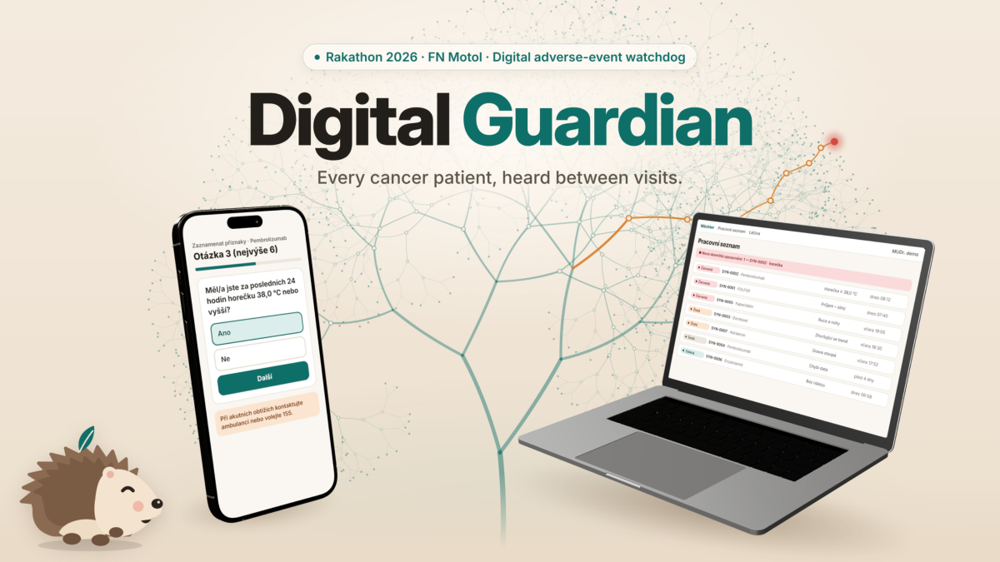
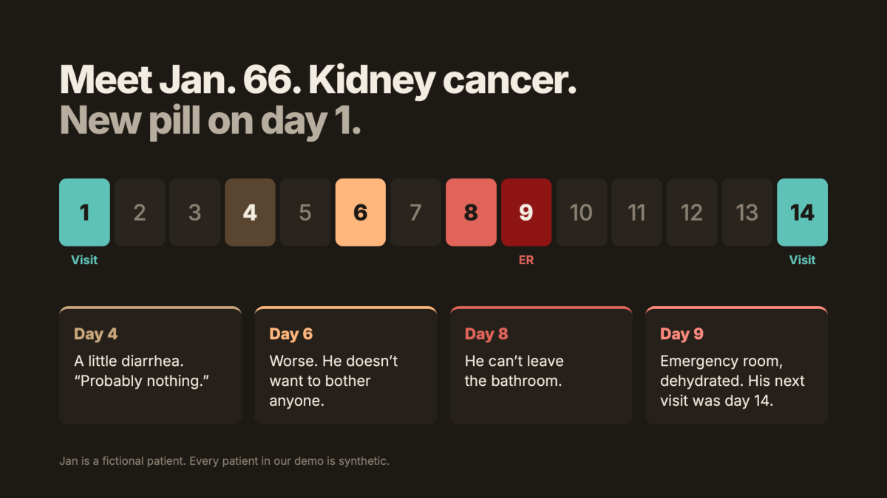
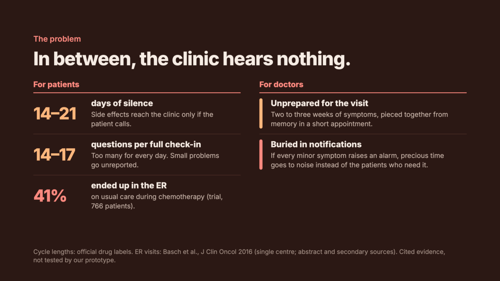
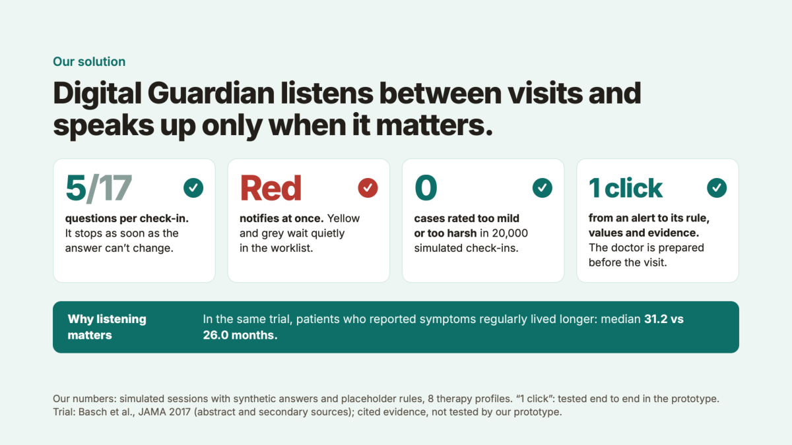
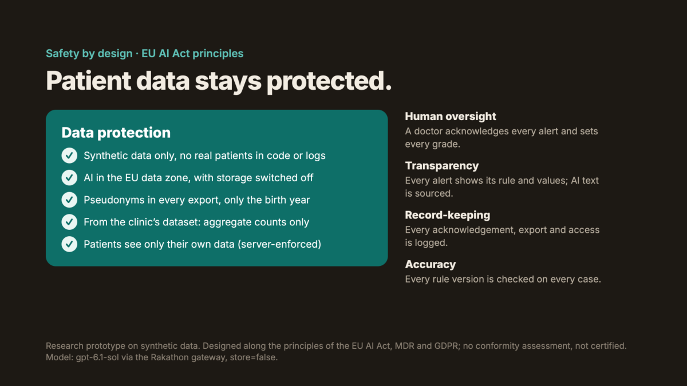
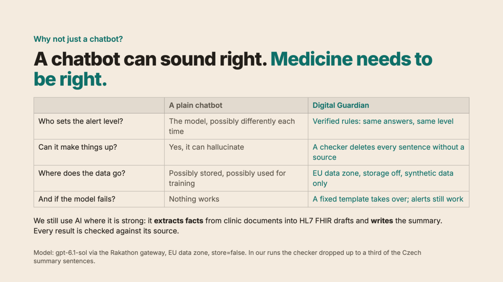
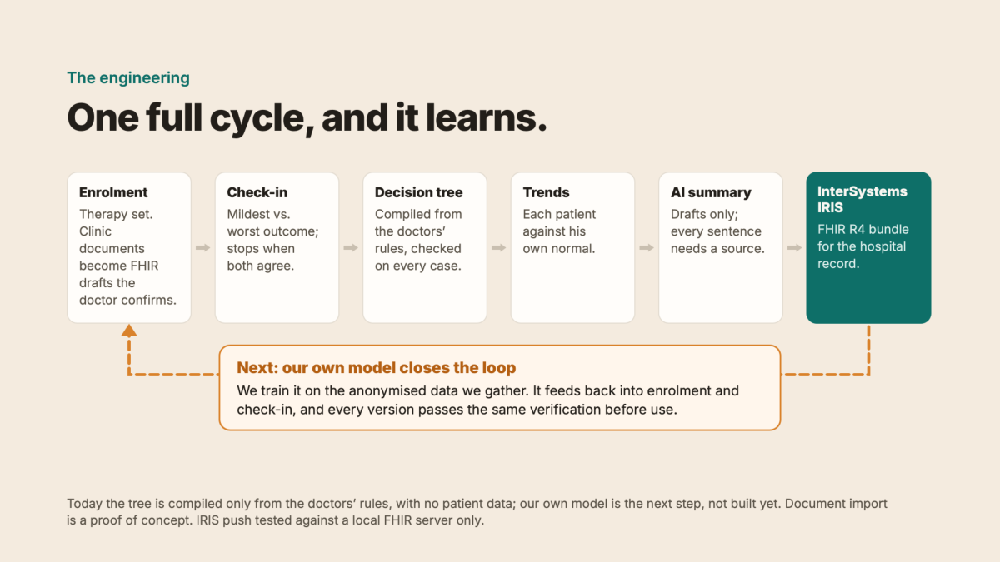
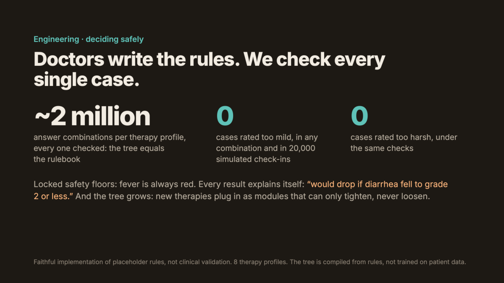
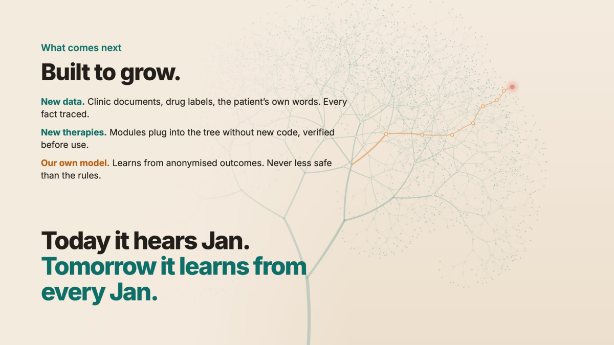

# Digital Guardian

**Every cancer patient, heard between visits.**

Rakathon 2026 · FN Motol · Challenge 3 „Digitální hlídač nežádoucích účinků“ (digital adverse-event watchdog)



> Research prototype on **synthetic data only**. No diagnosis, no therapy decision, no autonomous action. All clinical
> content (thresholds, safety floors, tips, triage rules) is a placeholder until a clinician approves it. A language
> model never sets a colour, level, grade or alert.

> **Questionnaire wording in this public version:** Digital Guardian is designed for the **official NCI PRO-CTCAE®
> item wording** (Czech, English and German), with the official 7-day recall at therapy start and a daily check-in
> afterwards. The NCI Terms of Use require registration and do not allow redistribution, so this public repository ships
> **our own wording structured after PRO-CTCAE** instead (not validated). To use the official items, register with the
> NCI and place the official texts in `challenge/content/items.yaml` (fields `question`, `question_daily`, `options`,
> `wording: official_wording`) – the application supports them unchanged. Likewise, the full SÚKL drug index
> (`challenge/content/sukl_index.csv`) is not included; it can be rebuilt from SÚKL Open Data with
> `challenge/content/tools/build_sukl_index.py`.

The full presentation is in [`docs/presentation/digital-guardian.pdf`](docs/presentation/digital-guardian.pdf).

---

## The story



Jan is a fictional patient: 66, kidney cancer, a new pill on day 1. A little diarrhea on day 4, worse on day 6, he does
not want to bother anyone, on day 9 he is in the emergency room, dehydrated. His next visit was day 14.

## The problem



Between visits the clinic hears nothing. A full symptom check-in has 14–17 questions – too many for every day – and if
every minor symptom raised an alarm, the team would drown in noise. The clinic's own brief: *„Chceme být ihned informováni
o závažných nežádoucích účincích, nikoli o každé drobnosti.“*

## Our solution



Digital Guardian listens between visits and speaks up only when it matters:

- **Short adaptive check-in** – about 5 instead of 17 questions; it stops as soon as no further answer can change the
  result. Designed for the official PRO-CTCAE wording (cs/en/de, 7-day recall at therapy start, then daily); this public version uses own wording.
- **Red notifies at once**, yellow and grey wait quietly in the worklist (noise brake; a worsening always breaks through).
- **Advice for the patient** – practical tips per symptom; on acute problems first the clinic's instruction: *„Při
  akutních obtížích kontaktujte ambulanci nebo volejte 155.“*
- **One click** from an alert to its rule, values and evidence – the doctor is prepared before the visit.
- **Free text** in the patient's own words: a language model maps it to symptoms as proposed follow-up questions; only
  the patient's own answer counts.
- **Clinic documents ⇒ HL7 FHIR drafts** that the doctor confirms item by item; drug search over the SÚKL database.

## Safety by design





- Levels come from verified rules and a compiled decision tree – same answers, same level. Locked safety floors (e.g.
  fever ⇒ red) cannot be configured away.
- The AI only drafts (summary, free-text mapping, document extraction); a deterministic checker deletes every sentence or
  proposal without a verbatim source. If the model fails, a fixed template takes over and alerts still work.
- Model `gpt-6.1-sol` via the Rakathon gateway in the EU data zone, `store=false`, synthetic data only. Pseudonyms in every
  export, server-enforced access, audit log.

## The engineering





| Measured (synthetic data, placeholder rules) | Result |
| --- | --- |
| Decision tree equals the rulebook | every grid point, up to ~2 million answer combinations per profile |
| Simulated check-ins (8 therapy profiles) | 20 000 sessions: 0 rated too mild, 0 too harsh |
| Questions per adaptive check-in | ≈ 5–6 instead of 14–17 |
| FHIR R4 export | 0 errors in the HAPI validator for all 7 synthetic patients |
| End-to-end tests | core path, 1366×768 cockpit without scrolling, 375 px patient pages |

This shows a **faithful implementation of placeholder rules**, not clinical validation.

## What comes next



New data sources (clinic documents, drug labels, the patient's own words, every fact traced), new therapies as modules that
can only tighten the rules, and our own model trained on anonymised outcomes – never less safe than the rules.

---

## Run the demo

Requirements: Python ≥ 3.12, Node ≥ 22, npm. No Docker needed.

```powershell
powershell -ExecutionPolicy Bypass -File scripts/setup.ps1 -SkipBrowser      # once
powershell -ExecutionPolicy Bypass -File challenge/demo/start.ps1 -Reset     # reset + start
```

Linux/macOS: `bash scripts/setup.sh` and `bash challenge/demo/start.sh --reset`. Open `http://127.0.0.1:5173`, password for
all demo accounts `demo-passwort-2026`:

| Account | Role |
| --- | --- |
| `patient2` | synthetic patient SYN-0002 – check-in, tips, free text |
| `doctor` | clinician – worklist, cockpit, acknowledgement, CTCAE grading, report, FHIR export, documents, new patient |
| `admin` | administration – additionally FHIR push |

Start the backend at least one minute before presenting (the triage trees are compiled and verified at start-up).
Optional live LLM: load the gateway configuration (not part of the repository) into the same shell before starting.
Click path: [`challenge/pitch/DEMO_RUNBOOK.md`](challenge/pitch/DEMO_RUNBOOK.md).

Tests: `scripts/test.ps1` / `scripts/test.sh` (ruff, mypy, pytest, eslint, prettier, tsc, vitest, build, optional
Playwright).

## Architecture

```
platform/            neutral web platform: login, roles, audit, design system, config loader (FastAPI + React)
challenge/
  backend/waechter/  plug-in: services (check-in, rules, alerts, triage, advice, summary, FHIR, documents, enrolment),
                     triage/ (safe parser, compiled entropy tree, verification), llm/ (adapters + deterministic checker)
  frontend/waechter/ patient and clinician UI (React, Tailwind)
  content/           versioned clinical content (items, regimens, rules, triage, advice) – all placeholders
  knowledge/         C61/C64 knowledge base from drug labels (SmPC 4.8), sourced per row
  contract/          OpenAPI, content schema, triage contract
  demo/              reset/start scripts, synthetic demo documents
  pitch/             pitch, claims with evidence, transparency, Q&A
docs/verification/   independent test reports
provenance/          origin of every file
```

Business logic lives in services and the triage core, never in routes or UI; authorisation is enforced server-side.
Details: [`challenge/ARCHITECTURE.md`](challenge/ARCHITECTURE.md), [`challenge/README.md`](challenge/README.md).

## Honest limits

- Synthetic patients only; the shared clinic dataset was used for aggregate counts only.
- Clinical content is not approved; cs/de texts are not reviewed by native speakers. The questionnaire wording
  in this public version is our own wording (see note above); the official NCI wording requires NCI registration.
- Free-text mapping and document extraction are proofs of concept; the deterministic checker is deliberately strict.
- FHIR push was tested against a local FHIR server only.

## Origin

Digital Guardian was built during the Rakathon (16–17 Oct 2026) on top of a neutral web platform (`platform/`: login,
roles, audit log, design system, no domain logic) that existed before the event. Everything in `challenge/` was written
during the event; changes to `platform/` during the event are listed in [`provenance/PROVENANCE.md`](provenance/PROVENANCE.md)
and [`provenance/TABLE.md`](provenance/TABLE.md).
